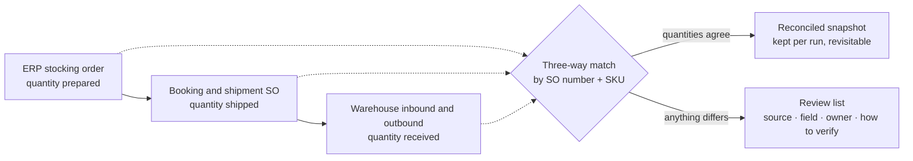
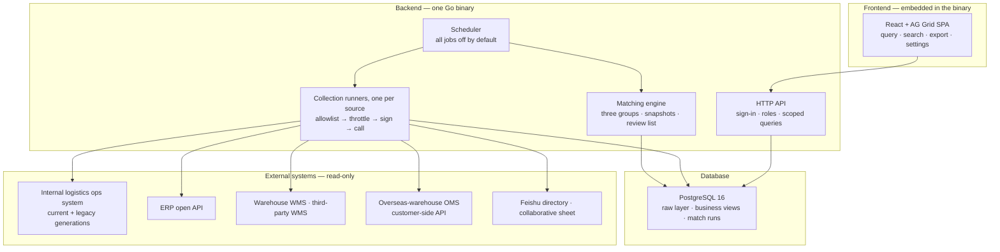

# Logistics Data Hub

**A cross-border logistics data foundation: read-only collection from seven external systems into one PostgreSQL, with automatic three-way reconciliation.**

One Go binary with the frontend embedded, plus PostgreSQL 16, running on NAS-class hardware. Every external access is read-only by construction; every credential is encrypted at rest.

[Overview](#-overview) · [Business Mainline](#-business-mainline) · [Architecture](#-architecture) · [Design Highlights](#-design-highlights) · [Guard Rails](#-guard-rails)

**English** · [简体中文](README.zh.md)

> [!NOTE]
> This is a **documentation-only showcase**: the source code lives in a **private repository**. No code, configuration or deployment material is published here. If you would like a code walkthrough, please contact the author.

## 📌 Overview

A cross-border logistics team's data used to live in seven separate systems, each exported and cross-checked by hand. This system collects all of them **read-only**, in batches, into a single PostgreSQL database — unified querying, full-text search and CSV export on top — and reconciles quantities automatically. Anything that does not add up lands on a review list that states the source, the field to check, who fixes it and how to verify.

The seven external sources, described generically:

| # | Source type | What it provides |
|---|---|---|
| 1 | Internal logistics operations system — current generation | Shipping orders, stock, inbound / outbound, fees |
| 2 | Internal logistics operations system — legacy customer portal | Historical orders, tracking, measured sizes |
| 3 | ERP open API | Stocking orders, purchasing, finance, returns |
| 4 | Warehouse WMS open API | Inbound, outbound, stock, warehouse fees |
| 5 | Overseas-warehouse OMS, customer-side API | Outbound and inbound order mirrors, storage-age detail |
| 6 | Third-party WMS | Orders and status history at a partner warehouse |
| 7 | Collaborative spreadsheet | Outbound request sheet maintained by the business |

## 🔀 Business Mainline

Goods move through three ledgers that were never designed to agree: the ERP says how much was **stocked**, the operations system says how much was **booked and shipped**, and the WMS says how much was **received or dispatched**. The matching engine joins them by **shipping-order number + SKU**:

Every matching run is stored as a snapshot, so verdicts can be revisited and scheduled runs can track first-valid-verdict and baseline-difference over time.

## ✨ Capabilities

- **Collection** — each source has its own runner: endpoint allowlist, throttling, retries, request signing, then batch writes. A batch records per-endpoint call counts, success rate and rows written; identical rows only bump their batch id, never duplicate. Incremental runs automatically re-query keys that never succeeded.
- **Browsing** — business views (shipping orders, stock snapshots, inbound / outbound, fees, returns) plus raw per-endpoint data, all searchable and exportable as CSV, with a field dictionary mapping raw field names to business meaning.
- **Reconciliation** — three matching groups covering stocked-vs-shipped-vs-received in pieces, box / piece conversion, and cumulative comparison for goods that arrive in partial transfers.
- **Accounts & audit** — Feishu sign-in provisioned from the directory with automatic offboarding; per-module role permissions; sign-in and operation logs; all schedules off by default.

## 🏗 Architecture

- **The raw layer loses nothing.** Every API response is stored as-is; business views are derived from it, so changing a rule means recomputing, not re-collecting.
- **Exactly one primary service** owns schedules and cleans up stale batches; CLI-triggered collection runs as a separate process and survives service restarts.
- **Deployment** is two containers — app and database — on a NAS-class box inside the LAN.

## 🧠 Design Highlights

- **Reconciliation as a product, not a script.** Mismatches are not errors to silence: each one becomes a review item with a stated source, suspect field, owner and verification method, and each run is a durable snapshot.
- **Batch bookkeeping with heartbeats.** Long-running collections write a per-minute heartbeat; the orphan sweeper only declares a batch interrupted when both calls and heartbeats have been silent, so slow disks cannot cause false interruptions.
- **Transactional page writes.** Each collected page commits raw rows, normalized rows and counters in one transaction — turning a 45-minute per-row crawl into roughly one minute on spinning disks.
- **Probe-first endpoints.** Endpoints with incomplete documentation are tried as probes; failures are disabled with a recorded reason and never block the batch.
- **Egress-IP awareness.** Sources that enforce IP allowlists are monitored: the UI shows the current egress IP and warns when it changes.
- **Every list is paginated** — server-side paging with selectable page sizes and an exact "x–y of N" counter, everywhere.

## 🛡 Guard Rails

- **All external access is read-only.** Each source passes an endpoint allowlist plus a write-verb interceptor in code, and guard tests fail the build if a write path ever appears in source. A write endpoint added to configuration by mistake still cannot be called.
- **One audited write exception.** The ERP remark write-back — the only write in the system — updates a single free-text remark field and sits behind four gates: an off-by-default switch, a dedicated permission, a per-batch cap, and read-back verification both before and after each write. Any gate failing stops the batch and flips the switch back off.
- **Credentials are encrypted at rest** and entered only through the settings UI; they never appear in code, logs, error payloads or test fixtures, and redaction is covered by tests.
- **Data scope is filtered on two dimensions per role** — by operations-system customer and by WMS customer — enforced in queries, so an account scoped to one customer can never see another's rows.
- **Deployment refuses to interrupt work.** The deploy path checks for running collection or matching batches first and declines to restart the service while any are active.

## 🧱 Tech Stack

| Layer | Technology |
|---|---|
| Backend | Go 1.27, pgx, cron scheduling, authenticated-encryption credential store |
| Database | PostgreSQL 16 — raw layer, business views, matching snapshots, SQL migrations |
| Frontend | React 18.3, TypeScript 5.5, Vite, AG Grid |
| Integrations | Seven read-only external data sources; Feishu for sign-in and directory |
| Deployment | Docker Compose, two containers, NAS-class hardware on a LAN |

## 📄 License

All rights reserved. Documentation only; no license is granted for the described implementation.
