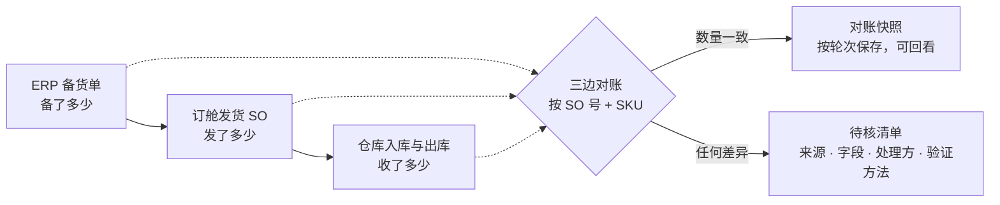
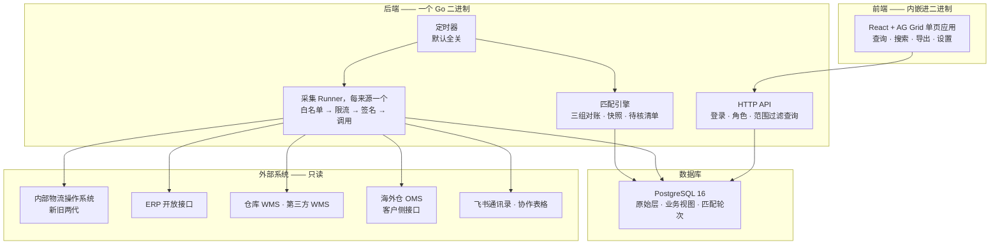

# 物流数据基座

**跨境物流数据基座：把 7 个外部系统的数据只读采集进一个 PostgreSQL，并自动做三边对账。**

一个 Go 单二进制（前端内嵌）+ PostgreSQL 16，跑在 NAS 级别的硬件上。所有外部访问从结构上保证只读；所有凭证加密落库。

[概览](#-概览) · [业务主链路](#-业务主链路) · [架构](#-架构) · [设计要点](#-设计要点) · [工程铁律](#-工程铁律)

[English](README.md) · **简体中文**

> [!NOTE]
> 这是一份**纯文档展示仓库**：源码在**私有仓库**中，这里不发布任何代码、配置或部署材料。如需代码走读，请联系作者。

## 📌 概览

一个跨境物流团队的数据原本分散在 7 个系统里，各自导表、人工核对。本系统把它们按批次**只读**采集进同一个 PostgreSQL —— 在上面做统一查询、全文搜索、CSV 导出 —— 并自动对账。对不上的每一条都进待核清单，写明来源、待核字段、处理方和验证方法。

7 个外部数据源（按通用说法描述）：

| # | 来源类型 | 提供什么 |
|---|---|---|
| 1 | 内部物流操作系统 —— 新一代 | 出货单、库存、出入库、费用 |
| 2 | 内部物流操作系统 —— 旧代客户门户 | 历史订单、路由跟踪、实测尺寸 |
| 3 | ERP 开放接口 | 备货单、采购、财务、退货 |
| 4 | 仓库 WMS 开放接口 | 入库、出库、库存、仓储费用 |
| 5 | 海外仓 OMS 客户侧接口 | 出入库单据镜像、库龄明细 |
| 6 | 第三方 WMS | 合作仓的订单与状态历史 |
| 7 | 协作表格 | 业务方维护的出库申请表 |

## 🔀 业务主链路

货物经过三本从未对齐过的账：ERP 记录**备了多少**，操作系统记录**订舱发了多少**，WMS 记录**收了 / 出了多少**。匹配引擎按**出货单号 + SKU** 把三边对起来：

每轮匹配结果都存成快照，判定可以回看；定时轮次还会记录「首次有效判定」和「起点差异」。

## ✨ 能力

- **采集** —— 每个来源一个 Runner：接口白名单、限流、重试、请求签名，再按批次写库。每个批次记录各接口的调用次数、成功率、写入行数；内容相同的行只更新批次号，不重复存。增量模式自动补查从未成功过的主键。
- **浏览** —— 业务视图（出货单、库存快照、出入库、费用、退货）加上每个接口的原始数据，都可搜索、可导出 CSV，并配有「原始字段名 → 业务含义」的字段字典。
- **对账** —— 三组匹配：备货 ↔ 发货 ↔ 收货的件数合计、箱件折算、以及分批转入场景下的累计比对。
- **账号与审计** —— 飞书登录、通讯录选人开通、离职自动停用；按模块的角色权限；登录日志与操作日志；定时任务默认全关。

## 🏗 架构

- **原始层不丢信息。** 每份接口响应原样保存；业务视图从原始层整理而来，口径改了可以重算，不用重新采集。
- **主服务唯一**：定时任务和遗留批次清理只归主服务管；命令行采集是独立进程，重启服务不会打断。
- **部署形态**：局域网内一台 NAS 级别的机器上，app + db 两个容器。

## 🧠 设计要点

- **把对账做成产品，而不是脚本。** 差异不是要吞掉的报错：每条差异都成为一条待核项，写明来源、可疑字段、处理方和验证方法；每一轮都是可回看的快照。
- **带心跳的批次记账。** 长时间采集每分钟写一次心跳；巡检要「调用和心跳都停满 10 分钟」才判中断 —— 慢盘不会再造成误判。
- **按页事务写库。** 每采一页，原始行、规整行、计数器在同一个事务里提交 —— 机械盘上逐行提交要 45 分钟的一页，降到一分钟左右。
- **接口先试探。** 文档不全的接口先按试探跑，失败的停用并记录原因，不拖累整批。
- **出口 IP 感知。** 对有 IP 白名单的来源做监控：页面显示当前出口 IP，变化时提醒。
- **所有列表都分页** —— 服务端分页、每页条数可选、精确显示「第 x–y 条，共 N 条」，全站一致。

## 🛡 工程铁律

- **所有外部访问只读。** 每个来源都要过接口白名单，代码里另有写操作词拦截；守卫测试保证源码中一旦出现写路径就构建失败。误把写接口加进配置也调不出去。
- **唯一一个受审计的写例外。** ERP 备注回写 —— 全系统唯一的写 —— 只改一个自由文本备注字段，并有四重闸门：默认关闭的开关、专门的权限、每批上限、写前写后各读回核对一次。任何一道闸不过就停批，并自动把开关关回去。
- **凭证加密落库**，只在设置页录入；不进代码、日志、报错和测试夹具，脱敏有测试覆盖。
- **数据范围按角色两维过滤** —— 操作系统客户一维、WMS 客户一维 —— 在查询层强制执行：授权到某个客户的账号永远看不到别家的行。
- **部署不打断在跑的活。** 部署脚本先查有没有进行中的采集或匹配批次，有就拒绝重启服务。

## 🧱 技术栈

| 层 | 技术 |
|---|---|
| 后端 | Go 1.27、pgx、cron 定时、认证加密的凭证存储 |
| 数据库 | PostgreSQL 16 —— 原始层、业务视图、匹配快照、SQL 迁移 |
| 前端 | React 18.3、TypeScript 5.5、Vite、AG Grid |
| 集成 | 7 个只读外部数据源；飞书用于登录与通讯录 |
| 部署 | Docker Compose、两个容器、局域网内 NAS 级硬件 |

## 📄 许可

保留所有权利。本仓库仅为文档展示；不就文中描述的实现授予任何许可。
